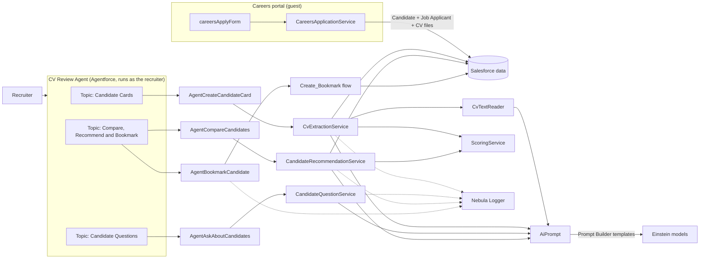
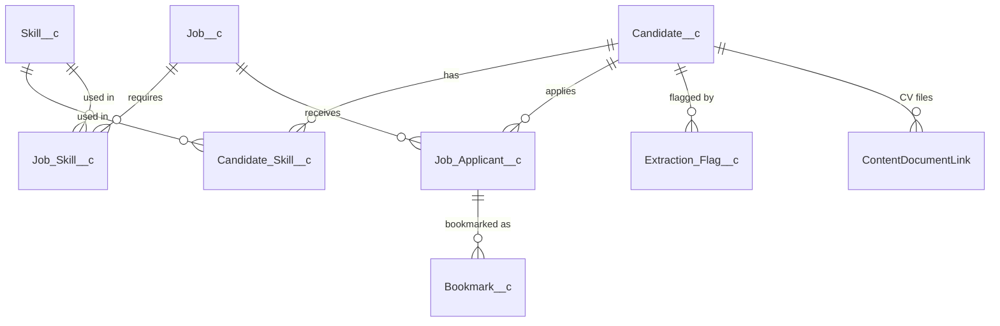

# CV Review Agent (Salesforce)

A recruiting assistant built on Salesforce for Clouding AI. Candidates apply from a public careers
portal. Recruiters then ask an Agentforce agent to:

- turn a candidate's CV into a structured **Candidate Card**, showing what is missing, inferred or
  conflicting;
- answer questions about candidates **from their CVs only**, with quotes as references;
- **compare and rank** the applicants of a job, with the reasoning, trade-offs and gaps to check in
  interview;
- **bookmark** a candidate with notes.

Every AI answer, recommendation and bookmark is logged for audit.

## Contents

1. [What's in the box](#whats-in-the-box)
2. [Architecture](#architecture)
3. [Data model](#data-model)
4. [How each feature works](#how-each-feature-works)
5. [Robustness](#robustness)
6. [Explainability and audit](#explainability-and-audit)
7. [Setup](#setup)
8. [Testing](#testing)
9. [Decisions and assumptions](#decisions-and-assumptions)
10. [Limitations](#limitations)
11. [If I had more time](#if-i-had-more-time)

## What's in the box

| Area                              | Components                                                                                                                               |
| --------------------------------- | ---------------------------------------------------------------------------------------------------------------------------------------- |
| Careers portal (Experience Cloud) | `careersJobList`, `careersJobDetail`, `careersApplyForm` LWCs, `CareersController`, `CareersApplicationService`                          |
| Recruiter app (Lightning)         | `Clouding HR` app, `candidateCard` and `jobApplicants` LWCs, record pages, `Clouding_HR` permission set                                  |
| Agent                             | `CV_Review_Agent` (Agent Script in `aiAuthoringBundles/`), 6 actions (`genAiFunctions/` + `Agent*` Apex classes), 6 conversation tests   |
| AI                                | 4 Prompt Builder templates: `CV_Read_Text`, `CV_Extract_Card`, `CV_Answer_Question`, `CV_Recommend`                                      |
| Services                          | `CvTextReader`, `CvExtractionService`, `CandidateQuestionService`, `CandidateRecommendationService`, `ScoringService`, `AiPrompt`        |
| Automation                        | `Create_Bookmark` (autolaunched flow), `Bookmark` (screen flow), validation rules `Score_Range` and `Score_Locked`                       |
| Shared code                       | `Constants`, `TestDataFactory`                                                                                                           |
| Logging                           | Nebula Logger (unlocked package)                                                                                                         |
| Demo                              | `scripts/demo/seed-demo.mjs` (jobs, candidates, CVs, photos), `demo/cvs` and `demo/photos`, `docs/DEMO_PLAN.md`, overview PDF in `docs/` |

## Architecture



Main points:

- **Candidates are created by the portal, never by the agent.** The portal creates the candidate,
  the application and the CV files. The agent only fills the card's empty fields from the CV.
- **One entry point to the AI.** `AiPrompt` is the only class that calls Einstein. It runs a
  Prompt Builder template and returns the text. Tests swap it for `AiPromptFake`, since Einstein
  can't run in Apex tests.
- **The AI writes text, Apex decides.** The score is computed by fixed rules in `ScoringService`.
  The AI explains the score but can't change it.
- **The agent is thin.** Each action is a small `@InvocableMethod` that checks its inputs, calls a
  service and returns a message written for the recruiter. The logic lives in services, which are
  tested without the agent.
- **Security.** Everything recruiter-facing runs `with sharing`, queries `WITH USER_MODE` and
  saves with `as user` DML. The agent is an Employee Agent, so it runs as the recruiter with their
  permissions. The only `without sharing` class is the portal's `CareersApplicationService`: the
  guest user has no create access, so that class stays narrow. It validates every field, only
  creates records and returns no ids.

## Data model



| Object               | Sharing (OWD)        | Role                            | Key fields                                                                                                                                                                                            |
| -------------------- | -------------------- | ------------------------------- | ----------------------------------------------------------------------------------------------------------------------------------------------------------------------------------------------------- |
| `Candidate__c`       | Public Read/Write    | The Candidate Card              | Name, Email (unique), Phone, Country, Current Title, Years of Experience, Summary, Experience, Education, Achievements, `CV_Text__c` (the CV text, source of truth for the AI), `Photo_Version_Id__c` |
| `Extraction_Flag__c` | Controlled by parent | One data problem on a card      | Type (Missing, Inferred, Conflict), Field, Detail                                                                                                                                                     |
| `Skill__c`           | Public Read Only     | Shared skill list               | Name                                                                                                                                                                                                  |
| `Candidate_Skill__c` | Controlled by parent | Skills of a candidate           | Candidate, Skill                                                                                                                                                                                      |
| `Job__c`             | Public Read Only     | A role                          | Name, Description, Location, Due Date, Min Years of Experience                                                                                                                                        |
| `Job_Skill__c`       | Controlled by parent | Skills a job needs              | Job, Skill, Importance (Must Have, Nice To Have)                                                                                                                                                      |
| `Job_Applicant__c`   | Controlled by parent | A candidate evaluated for a job | Score (0 to 100), Reasoning                                                                                                                                                                           |
| `Bookmark__c`        | Private              | A recruiter's saved candidate   | Job Applicant (lookup), Notes, plus formula fields for candidate, job and score                                                                                                                       |

The model is kept small on purpose. Who and when come from the standard fields (`CreatedById`,
`CreatedDate`, `OwnerId`). CV files are standard Salesforce Files. There are no snapshot or status
fields: the match level is derived from the score, and the breakdown is written in `Reasoning__c`.

## How each feature works

### 1. Candidate Card from a CV

**Ask the agent:** "Create the card of Karim El Fassi" or "Create the cards of the Senior Salesforce
Developer applicants".

1. **Read the CV.** `CvTextReader` gets the text of the candidate's latest CV file:
   - **PDF:** read by the AI (`CV_Read_Text`, with the file as input), scanned CVs included.
   - **DOCX:** read in Apex (a `.docx` is a zip; the text is in `word/document.xml`).
   - **TXT:** read as is.
   - Anything else (old `.doc`, images): not readable. This becomes a Missing flag asking for a
     PDF or DOCX.
2. **Extract.** `CV_Extract_Card` turns the text into JSON: card fields, skills, and flags. It is
   told the existing skill names so it reuses them.
3. **Fill, never overwrite.** `CvExtractionService` fills only the fields that are empty on the
   record. When the CV disagrees with a value already on the record (name, email, phone, country,
   title, or years differing by more than 0.5), the record keeps its value and a **Conflict** flag
   shows both. Skills are added, never removed.
4. **Flags.**
   - **Missing:** not in the CV and not on the record.
   - **Inferred:** not stated, deduced from the CV (for example years computed from job dates, or
     a skill implied by the work described).
   - **Conflict:** two sources disagree (the CV and the record, or two parts of the CV).

   The flags are replaced on each run, so they always describe the current state.

5. **Score.** The candidate's applications are scored (see feature 3).

Each candidate is saved in its own savepoint: one bad CV doesn't block the others. The agent
handles at most 3 candidates per request (each needs two AI calls), and names the others so the
recruiter can ask again.

The **Candidate Card** component shows the result on the record page:

- the photo or initials, title, country and years;
- the flag counts as coloured pills;
- two collapsible sections: **Skills** (the first 10, then "Show more"), and **Data quality**
  (collapsed by default), which lists each flag with its field and detail.

In a job's applicant list, the same component is a compact tile with the score.

### 2. Grounded Q&A

**Ask the agent:** "Who has worked with Docker among the Senior Salesforce Developer applicants?"

`CandidateQuestionService` sends the question with each candidate's `CV_Text__c` as numbered
sources. That's at most 20 candidates and 12,000 characters per CV. The `CV_Answer_Question` prompt
answers only from those sources, quotes the CV for each claim, and says when a CV doesn't state
something instead of guessing. The answer also notes when a candidate has no CV text yet, or when
a CV was cut.

### 3. Comparison and recommendation

**Ask the agent:** "Compare the applicants for Senior Salesforce Developer".

1. **Score (rules, not AI).** `ScoringService`:

   | Criterion           | Weight | Points                                                |
   | ------------------- | ------ | ----------------------------------------------------- |
   | Must-have skills    | 60     | share of the job's must-have skills the candidate has |
   | Nice-to-have skills | 20     | share of the nice-to-have skills                      |
   | Experience          | 20     | candidate years / required years, capped at 1         |

   `score = round(earned / sum of the weights that apply * 100)`. A criterion the job doesn't use
   is left out, not counted as zero. Unknown years earn 0 when the job has a minimum. Levels:
   75 or more is a strong match, 50 or more partial, under 50 weak.

2. **Rank.** By score, then by must-have skills matched, then by name.
3. **Explain (AI).** `CV_Recommend` gets the ranking, each score breakdown and the CV texts. It
   returns a recommendation and, for each applicant, the strengths, concerns and interview
   questions. When no one is a strong match, it says so and presents the best option with the
   gaps to check.
4. **Save.** The score and the reasoning are saved on the Job Applicant. The reasoning starts with
   the score breakdown, so it is readable without the agent.

If the AI call fails, the agent still returns the ranking and breakdown.

### 4. Bookmarking

**Ask the agent:** "Bookmark Julia Novak", then give the notes, then confirm.

The action runs the `Create_Bookmark` flow, the same one as the **Bookmark** button on a Job
Applicant. A recruiter gets one bookmark per applicant: asking twice returns the existing one.
Bookmarks are private to their owner. The bookmark shows the candidate, role and score through
formula fields, and the reasoning through a Related Record component. The time and the recruiter
come from the standard fields.

## Robustness

| Situation                                    | Behaviour                                                                                            |
| -------------------------------------------- | ---------------------------------------------------------------------------------------------------- |
| Unreadable file (`.doc`, image, damaged PDF) | A Missing flag on the card saying why, and what to ask the candidate for. The details go to the log. |
| Empty CV or not a CV                         | `NO_CV_TEXT` from the read template, reported on the card                                            |
| Very long CV                                 | Text cut at 131,072 characters, and the agent says so                                                |
| AI returns invalid JSON or an empty answer   | Clear error for that candidate. The others continue.                                                 |
| AI adds "N/A", "unknown" or a courtesy line  | Treated as empty / removed (`AiPrompt.text`, `AiPrompt.withoutCourtesy`)                             |
| Value on the record differs from the CV      | Record kept, Conflict flag with both values                                                          |
| Too many candidates in one request           | First 3 done, the others listed: "ask again to continue"                                             |
| Wrong or missing ids from the agent          | `AgentInputs` validates them and returns a friendly message instead of an error                      |
| AI unavailable during a comparison           | Ranking and breakdown returned without the AI text                                                   |
| A score already exists                       | Kept: `Score_Locked` prevents changes, so bookmarks keep showing the score that was saved            |
| Portal abuse                                 | Field, size and file-type checks. One application per job and email. No data returned to the guest.  |

## Explainability and audit

- **Explainability.** Every score comes with its breakdown (for example "Must-have skills: 1 of 3,
  has Apex, missing LWC and SOQL"). Every Q&A claim quotes the CV. Every flag says what is
  missing, inferred or conflicting, and why.
- **Audit log.** Nebula Logger records every agent recommendation, answer and bookmark with the
  tag `Agent Decision`, and the card runs with `CV Extraction`. Each entry records the user, the
  inputs and the result. Logs are Platform Events, so they survive a rollback.
- **Score calculation document:** "CV Review Agent - How the score is calculated.pdf" has worked
  examples.

## Setup

Prerequisites: a Salesforce org with Agentforce, Einstein generative AI, Prompt Builder and
Experience Cloud enabled, plus the Salesforce CLI.

```bash
# 1. Nebula Logger (unlocked package, no namespace)
sf package install --package 04tg7000000IzRdAAK --security-type AdminsOnly --wait 20 -o <org>

# 2. Metadata: objects, Apex, LWC, flows, prompt templates, agent actions, tests, permission set
sf project deploy start -o <org>

# 3. The agent (from its Agent Script source)
sf agent validate authoring-bundle --api-name CV_Review_Agent -o <org>
sf agent publish authoring-bundle --api-name CV_Review_Agent -o <org>
sf agent activate --api-name CV_Review_Agent -o <org>

# 4. Demo data: 4 jobs, 5 candidates with their CV and photo, 13 applications
node scripts/demo/seed-demo.mjs --org <org>          # add --fill-cards to fill the cards now
sf apex run --file scripts/apex/seed-careers-jobs.apex -o <org>   # extra portal jobs
```

The demo CVs are built from `scripts/demo/build_cvs.py` (`python3 scripts/demo/build_cvs.py`,
needs weasyprint and pandoc). Four of the people are fictional. Fatima-Ezzahra's CV is real, with the
CV Review Agent project added. The demo plan, with what to type and the expected scores, is in
[docs/DEMO_PLAN.md](docs/DEMO_PLAN.md).

Then assign recruiters the `Clouding_HR` permission set (app, objects, Apex classes and agent
access) and the standard **Prompt Template User** permission set. The agent opens from the
Agentforce icon in the Lightning header.

## Testing

| Suite               | What it covers                                                                                                                                                             | Command                                                                 |
| ------------------- | -------------------------------------------------------------------------------------------------------------------------------------------------------------------------- | ----------------------------------------------------------------------- |
| Apex                | All services, agent actions, controllers, flows, the portal. The AI is replaced by `AiPromptFake`. Data comes from `TestDataFactory`.                                      | `sf apex run test -o <org> --test-level RunLocalTests --wait 20`        |
| Agent conversations | 6 conversations against the live agent on the demo data (seeded with `--fill-cards`): card, card question, Q&A, two comparisons (strong match, no strong match), off-topic | `sf agent test run --api-name CV_Review_Agent_Tests -o <org> --wait 15` |

Current results: 83 Apex tests pass. The agent tests pass on actions and answers.

The AI prompts were also checked by hand against real CVs:

- a clean CV gives no flags;
- a messy PDF gives the expected conflicts, inferred and missing values;
- a DOCX reads correctly;
- answers quote the CV.

Note on the agent tests: the new Agentforce builder sometimes reports its router (`agent_router`)
as the topic. So the topic check can fail even when the right topic ran. The actions check is the
reliable routing check, and it passes on all 6 cases.

## Decisions and assumptions

- **Fill, don't create.** The portal already creates the candidate, so "creating a Candidate Card"
  means filling the empty fields from the CV. Values typed by a person (or by the candidate on the
  portal) are never overwritten. Differences become Conflict flags for a human to resolve.
- **CV text stored once** (`CV_Text__c`). The file is read once. Questions and comparisons then
  read plain text, which is faster and cheaper than sending files to the AI each time, and the
  recruiter can see exactly what the AI saw.
- **Deterministic scoring.** Same data, same score, every point explainable. The AI explains the
  score but never sets it, so its text can't contradict the number.
- **Scored once.** A score is locked once saved, because bookmarks show it. Re-scoring would
  change what an existing bookmark shows. So an application is only scored once its candidate's
  card is filled from the CV: filling one card scores that candidate only, and a comparison
  ranks applicants without a card but doesn't save their score.
- **No automatic rejection.** The assignment asks for the best available option when no one is a
  strong match. A human decides, based on data that may be uncertain.
- **No triggers.** Every rule considered was a validation or a duplicate check: validation rules
  and the services cover them.
- **Prompt Builder templates instead of prompts in Apex.** Admins can read and version the prompts.
  Models are set per template (Haiku to read PDFs, Sonnet for extraction, Q&A and recommendation).
- **Agent Script in the repo.** The agent (topics, instructions, action settings) is source code
  and can be rebuilt with the CLI, no clicks.
- **Assumptions:**
  - one CV per candidate is current (the latest file whose title starts with "CV", otherwise the
    latest readable file);
  - skills match by name;
  - recruiters work as one team, so candidates are shared.

## Limitations

- At most 3 Candidate Cards per agent request: AI calls are synchronous.
- Old binary `.doc` files can't be read: the card asks for a PDF or DOCX.
- Q&A reads at most 20 candidates and 12,000 characters per CV per question.
- Skill synonyms ("JS" and "JavaScript") are different skills unless they share a record.
- Experience is measured in years only: no recency, no relevance.
- Scoring weights are constants in code.
- AI output can still be wrong: the flags and quotes are there so a recruiter can check it.

## If I had more time

- **Background processing** (Queueable) to create many cards at once, with a progress notification.
- **Evidence on records:** a CV quote stored on each skill and flag.
- **Score history** (an `Evaluation__c` per run), so applicants can be re-scored while bookmarks
  keep the score the recruiter saw.
- **Configurable weights** in Custom Metadata.
- **Skill synonyms** (`Skill_Alias__c`).
- **Structured experience and education** as child records.
- **Semantic search** over many CVs (Data Cloud vector search).
- **Pipeline stages** on applications.
- **Privacy:** Shield encryption on personal data, and a retention job for GDPR.
- **Dedicated agent audit object** with the cited sources, next to the Nebula logs.
